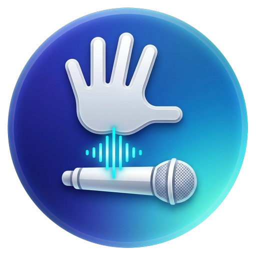

# Wristle++

<p align="center">
  
</p>

<p align="center">
  <strong>Fast, private, push-to-talk wrist dictation for Windows.</strong><br>
  Wear OS 5 (Material 3) · Native C++17 Windows Service · On-Device NPU Speech Recognition · ChaCha20-Poly1305
</p>

<p align="center">
  <a href="#key-advantages-over-original-wristle">Comparison</a> •
  <a href="#architecture">Architecture</a> •
  <a href="#features">Features</a> •
  <a href="#quick-start">Quick Start</a> •
  <a href="#building-from-source">Building</a> •
  <a href="#license">License</a>
</p>

---

> [!NOTE]
> **Fork Notice**: Wristle++ is a ground-up re-engineering and modernization of the original [unknownprocess/wristle](https://github.com/unknownprocess/wristle).

---

## 💡 Overview

**Wristle++** transforms your Wear OS watch (such as Samsung Galaxy Watch 7 / 6 / Ultra or Google Pixel Watch) into an ultra-fast, wireless **push-to-talk Walkie-Talkie dictation device** for your Windows PC.

Hold the hardware button on your watch, speak, and release: your recognized text is typed directly under your cursor in **any active Windows application** (VS Code, Chrome, Slack, Word, Terminal, Discord).

### What makes Wristle++ completely different?

The original project required installing third-party virtual audio cables (VB-CABLE), running heavy Python background scripts, and configuring external paid dictation utilities (like Hex or Handy) to listen to the virtual microphone.

**Wristle++ eliminates all of that.** It is an entirely self-contained, native, and audio-stream-free system:
1. **Zero Virtual Audio Cables:** No VB-CABLE, no audio drivers, no microphone conflicts.
2. **Zero Third-Party Dictation Apps:** No need for Hex, Handy, or desktop Whisper wrappers.
3. **Zero Audio Streaming over Network:** Speech is recognized 100% on-device on the watch via hardware NPU (`SpeechRecognizer`). Zero audio jitter, zero Wi-Fi packet drops, zero microphone delay, and minimal watch battery drain.
4. **Lightweight Windows C++ Service:** A tiny, instant background service that receives encrypted text strings, authenticates with ChaCha20-Poly1305, and injects directly into the cursor of any active Windows app. Zero heavy AI models, 0% CPU/GPU idle load, and instant startup.

---

## 📊 Key Advantages over Original Wristle

| Capability | Original Wristle | Wristle++ |
| :--- | :--- | :--- |
| **PC Architecture** | Python 3 + PyAudio + `pynput` | **Native C++17 Service** (Zero external runtimes) |
| **Audio Virtualization** | **Required VB-CABLE** virtual driver | **None** (Direct Win32 cursor text injection) |
| **Dictation Engine** | Relied on 3rd-party apps (Hex/Handy) | **100% On-Device NPU** (Wear OS SpeechRecognizer) |
| **Network Payload** | Continuous raw audio streaming | **Encrypted text packets only** (Zero audio on Wi-Fi) |
| **Watch UI Framework** | Legacy Android Java Views | **Wear OS 5 / Material Design 3 Jetpack Compose** |
| **Dictation Latency** | ~1.5 – 3.0 seconds (audio stream + queue) | **< 300 ms** (Burst Mode instant delivery) |
| **Text Feedback on Watch** | None | **Live & final text display** (Bezel scrollable) |
| **Hardware Button Support** | Basic key hook | **True Walkie-Talkie PTT**, Double Pinch, Knock |
| **Rotary Navigation** | None | **Samsung Touch/Physical Bezel** (Scroll & 5s step adjust) |
| **Encryption** | Basic / unencrypted UDP streams | **ChaCha20-Poly1305 AEAD (RFC 8439)** + SHA256-HMAC |
| **Speech Language** | Hardcoded system locale | **English (`en-US`) default** + System toggle |
| **Launcher Entries** | 2 duplicate icons on watch | **Single clean launcher icon** |
| **Network Recovery** | Manual restart | **Smart Wi-Fi auto-retry**, countdown & pause controls |

---

## 🏗️ Architecture

```
[ Wear OS 5 Watch (Galaxy Watch 7) ]
  │
  ├─► Hardware PTT / Complication / Touch Mic
  ├─► Exynos NPU On-Device SpeechRecognizer (Live + Final Text)
  ├─► Rotary Bezel Text Scroll & Curved Arc Page Navigation
  ├─► ChaCha20-Poly1305 AEAD Authenticated Encryption
  │
  ▼ Local Wi-Fi (Encrypted TCP 41083 / UDP Discovery 47821)
  │
[ Windows Native C++ Service (wristle_service.exe) ]
  │
  ├─► WinSock2 Multi-Client Non-Blocking Event Server
  ├─► ChaCha20-Poly1305 AEAD Decryption & Session Auth
  ├─► AttachToInputDesktop: Universal Keystroke Injection
  │
  ▼
[ Active Windows Window (VS Code, Chrome, Terminal, Office, Slack) ]
```

---

## ✨ Features

### ⌚ Wear OS Watch App (`watch/`)
- **Wear OS 5 Material Design 3 UI:** Built with modern Jetpack Compose for circular screens (tested on Samsung Galaxy Watch 7 40mm).
- **Walkie-Talkie Push-to-Talk (PTT):**
  - **Hold to talk, release to send:** Supports watch hardware buttons (`KEYCODE_STEM_1`, `KEYCODE_STEM_PRIMARY`).
  - **Lock Mode:** Single short tap starts recording hands-free; tap again to send.
  - **Cancel Button:** Discard mistake recordings instantly with haptic feedback.
- **Live & Final Text Display:**
  - Recognized text appears between the center mic button and the bottom curved arc indicator without overlapping.
  - **Rotary Bezel Scrolling:** Scroll through long recognized text using Samsung physical or touch rotary bezel (`onRotaryScrollEvent`). Default scroll position is never shifted automatically.
  - Automatically resets text upon beginning a new recording.
- **Language Switcher:**
  - Defaults to **English (`en-US`)** for reliable recognition.
  - 1-tap switcher in Settings to use **System Default** language.
- **Samsung One UI Gestures:** Integrated shortcuts to configure Samsung Double Pinch and Knock gestures for instant dictation.
- **Curved Bottom Page Indicator:** Bezel-conforming curved arc indicator along the bottom display edge for horizontal swipe navigation between the Main and Settings screens.
- **Smart Connection & Wi-Fi Recovery:**
  - Real-time countdown timer for PC search retries.
  - Minimalist Material 3 Wi-Fi retry icon and play/pause search button.
  - Adjustable timeouts (PC service: default 10s; Wi-Fi: default 30s) configurable in 5-second increments using the rotary bezel.
- **Zero Battery Drain:** Uses Burst Mode (instant text transmission over local TCP), avoiding battery-hungry continuous audio streams.

### 🖥️ Windows Native Service (`desktop/`)
- **Zero External Dependencies:** Compiled C++ executable without Python, Node.js, or virtual audio cable drivers.
- **Universal Cursor Text Injection:**
  - Atomic clipboard injection (`SetClipboardData(CF_UNICODETEXT)` + synthesized `Ctrl+V`) with automatic background restore of user's previous clipboard contents within 800ms.
  - Compatible with 100% of Windows software: Electron apps (VS Code, Discord, Slack, Obsidian), Chromium browsers, Microsoft Office, and Windows Terminal.
  - `AttachToInputDesktop` integration guarantees text injection even when running as a background service across different Windows desktop sessions.
- **Bank-Grade Security:** Mutual pairing authentication with a 4-digit verification code and ChaCha20-Poly1305 AEAD authenticated encryption.
- **Built-in Service Manager:** Run interactively, run as a background task, install to Windows Registry autostart, or install as a native Windows SCM Service.

---

## 🚀 Quick Start

### 1. Windows PC Setup

Download or build `wristle_service.exe`, then run it in interactive mode:

```cmd
desktop\wristle_service.exe run
```

Command-line options:
```cmd
desktop\wristle_service.exe run             # Interactive mode (for first-time pairing)
desktop\wristle_service.exe start           # Run silently in background
desktop\wristle_service.exe stop            # Stop background service
desktop\wristle_service.exe status          # Check running status
desktop\wristle_service.exe install         # Set up autostart at Windows user login
desktop\wristle_service.exe install-service # Register as Windows System Service (Admin)
```

### 2. Watch App Installation (Wear OS)

Install the debug APK on your watch over Wi-Fi ADB:

1. On your watch, navigate to **Settings** → **System** → **About** → **Software Info**, and tap **Build number** 7 times to enable Developer Options.
2. In **Settings** → **Developer Options**, enable **ADB debugging** and **Wireless debugging**.
3. Tap **Pair new device** and note the IP, pairing port, and 6-digit pairing code.
4. On your PC:
   ```cmd
   adb pair <WATCH_IP>:<PAIRING_PORT> <PAIRING_CODE>
   adb connect <WATCH_IP>:<DEBUG_PORT>
   adb install -r watch/build/outputs/apk/debug/watch-debug.apk
   ```

### 3. Pairing Watch and PC

1. Open **Wristle** on your watch and grant microphone permission.
2. The watch will automatically discover your PC on the local network and display a 4-digit pairing code (e.g. `1234`).
3. On your PC console running `wristle_service.exe run`, confirm with `y` + Enter.
4. Done! Click any text box on your PC, hold the button on your watch, talk, and release.

---

## 🔨 Building from Source

### Prerequisites
- **Windows:** CMake 3.20+, Ninja or Visual Studio (MSVC / C++17).
- **Android / Wear OS:** Android SDK 35 (Platform Tools), Java 17 LTS, Gradle Wrapper.

### Build Windows C++ Service
```cmd
cd desktop
cmake -B build -G "Ninja" -DCMAKE_BUILD_TYPE=Release
cmake --build build
```

### Build Wear OS App
```cmd
.\gradlew.bat :watch:assembleDebug
```
The output APK is generated at:
`watch/build/outputs/apk/debug/watch-debug.apk`

### Run Unit Tests
```cmd
.\gradlew.bat :watch:testDebugUnitTest
```

---

## 🔒 Privacy & Security

- **100% Local:** Speech is recognized on-device via your watch's Exynos NPU. No audio ever leaves the watch.
- **No Cloud, No Accounts:** No registration, no telemetry, no tracking.
- **End-to-End Encryption:** All text traffic over your local Wi-Fi is encrypted using ChaCha20-Poly1305 AEAD with 256-bit symmetric keys established during initial pairing.

---

## 📄 License

This project is licensed under the [MIT License](LICENSE).
Original project copyright (c) unknownprocess.
Enhancements and Wristle++ modifications copyright (c) 2026 pacodelavega.
